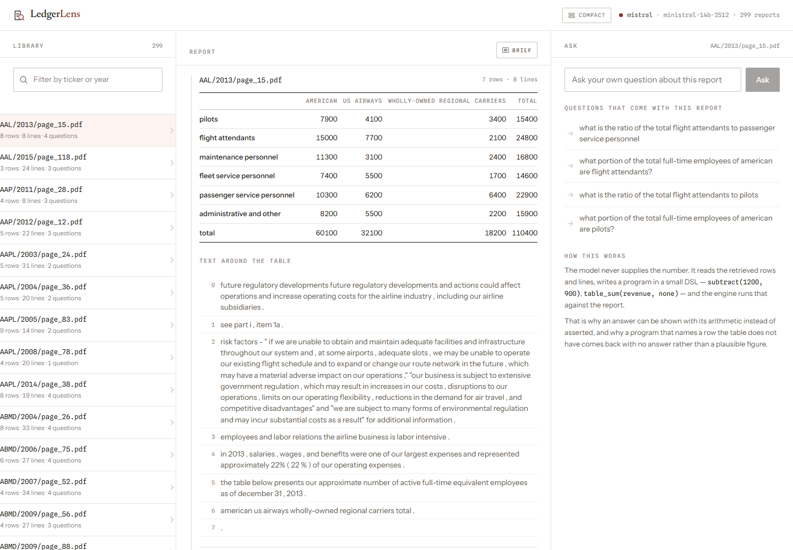
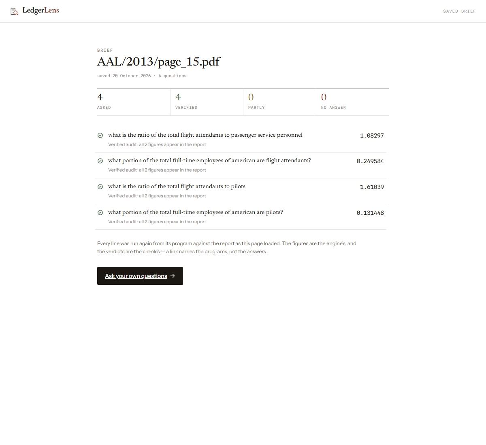
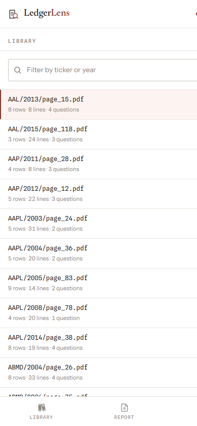

# LedgerLens AI

**Auditable financial question answering — every figure in an answer is checked against the report, and the arithmetic is done by a deterministic engine, not the model.**

[**Try the live demo** — ledgerlens-blond.vercel.app](https://ledgerlens-blond.vercel.app)



| A brief, saved and opened by link | The same app at phone width |
| --- | --- |
|  |  |

## What it is

Ask a financial report a question like "how much did operating income grow between 2022 and 2023".
LedgerLens retrieves the evidence, has a language model write a small calculation program, runs that
program on a deterministic engine, and checks every figure in it against the report before showing an
answer — with the rows it read and the steps it took attached, so an answer can be checked rather
than trusted.

The design point is the division of labour. Plain search finds the words but can't calculate; a plain
LLM writes confident paragraphs with subtly wrong numbers in them. So retrieval finds the evidence, a
small engine does the arithmetic, and the model reads the question and writes the program. The model
never supplies a figure for the answer: every numeric literal it writes is classified against the
whole document, and a program built entirely out of figures the report does not state is refused
instead of answered. When it can't find what a question needs, it says so.

## Features

- **Evidence retrieval** — BM25 over tables and narrative, with a reranker tuned on the train split
  (`docs/retrieval-evaluation.md`).
- **Deterministic calculations** — arithmetic, table aggregations and named financial formulas run in
  a tested engine (`docs/calculation-engine.md`).
- **Figure verification** — every number is grounded against the source report, or the answer is
  refused with the reason (`docs/verification.md`).
- **Auditable answers** — the program, the steps, the rows read and the check's verdict ride along
  with every answer, and can be saved and re-opened by link.
- **Reproducible evaluation** — recorded runs with committed configs and metrics; nothing quoted
  without its run directory (`docs/evaluation.md`).
- **Runs without a key** — the model layer is provider-neutral and defaults to an offline provider.
  Switching to Gemini, Groq, Mistral, NVIDIA Build, OpenRouter or OpenAI is configuration, not code.

## Evaluation at a glance

Recorded on FinQA's dev split — 883 questions, one model (`ministral-14b-2512`, free tier), no failed
calls. `strict` is FinQA's own rule (match within 1e-3). `percent-equivalent` is a **diagnostic**, not
a second headline: it additionally accepts an answer a hundred times the reference, because FinQA
stores some percentages as fractions and "93.5" for 0.935 is not always wrong.

| System | strict | percent-equiv. (diagnostic) |
| ---- | ---- | ---- |
| A — the whole document in the prompt | 22.3% | 51.1% |
| D — retrieve, then write a program | 33.0% | 50.5% |
| E — D + figure check and one repair pass | 34.9% | 53.5% |

The honest reading: strict moved (+10.7 points A→D) while the looser column did not — the
gain is real in the strict convention and invisible under the percentage disagreement FinQA's storage
invites. The repair pass fired on 108 of 883 questions and fixed 9 net; the run-to-run noise on
unchanged code is ±30 questions, so the headline gain from E is inside noise and is reported as the
honest size of the feature, not a claimed improvement.

These are benchmark results under the measurement protocol in `docs/evaluation_protocol.md`. They are
not evidence of reliability on arbitrary real-world financial PDFs — PDF ingestion is not built, the
benchmark supplies tables pre-parsed, and the difference between the two tracks is not blurred.
Grounding, calculation correctness and answer correctness are three different properties and are
measured separately throughout.

Full results, error analysis, ablations and every run directory: **[docs/evaluation.md](docs/evaluation.md)**.

## Architecture

```
question ─▶ retrieval ─▶ model writes a program ─▶ engine executes it ─▶ figure check ─▶ answer
                ▲                                                        │
                └─────────────── report tables + narrative ──────────────┘

every answer carries the program, the steps, the rows read and the check's verdict
```

- **Backend** — Python 3.12, FastAPI, Pydantic; the model adapter speaks plain HTTP, no vendor SDK.
- **Frontend** — React 18, TypeScript, Vite, hand-written CSS; no component library.
- **Data** — the FinQA dev split (883 questions, 299 report pages), fetched at build time, never committed.
- **Saved briefs** — Postgres (Neon), one table, one migration.
- **Hosting** — Vercel: one Python function plus a static build; no second code path between local and deployed.

Typefaces are self-hosted under the SIL Open Font License, with the licence text
beside them.

## Run it locally

```
git clone <url>
cd ledgerlens-ai
python -m venv .venv
.venv\Scripts\activate            # Windows — or: source .venv/bin/activate on macOS/Linux
pip install -e ".[dev]"
```

```
copy .env.example .env            # Windows CMD — Bash/macOS/Linux: cp .env.example .env
```

No API key needed. `LLM_PROVIDER` defaults to `fake`, and the point of that default is honesty about
what it does: every code path runs — retrieval, program attempt, engine execution, verification,
error handling — with no key, no network and no spend, but the provider's replies are clearly-marked
placeholders rather than financial analysis, so the answers are real only once you configure a real
provider. That is also how the evaluation harness and its error handling are tested. Switching to
Gemini, Groq, Mistral, NVIDIA Build, OpenRouter or OpenAI is configuration, not code — set
`LLM_PROVIDER`, `LLM_MODEL` and one environment variable with your key. Free-tier notes (dated;
terms change without notice) are in `docs/deployment.md`.

Backend and frontend together:

```
cd backend
uvicorn app.main:app --reload         # API on http://127.0.0.1:8000
```
```
cd frontend
npm ci && npm run dev                 # UI on http://localhost:5173, /api proxied to the API
```

Tests, offline:

```
python -m pytest
```

No key needed for any of the above. The two no-cost offline measurements (engine replay, retrieval
ceiling) are listed in `docs/calculation-engine.md` and `docs/retrieval-evaluation.md`.

### Saved briefs (optional)

The one feature that wants a database. Point `DATABASE_URL` at any Postgres and run
`python scripts/migrate.py` once — one table, one migration file in `backend/migrations/`. Without it
the app works and the share button answers with the reason it cannot.

### Deploy (optional)

One Vercel function and a static build; `vercel.json` is the whole deploy. Instructions,
environment variables, migrations and rollback: **[docs/deployment.md](docs/deployment.md)**.

## Documentation

| Doc | What's in it |
| --- | --- |
| [`docs/architecture.md`](docs/architecture.md) | the request path, layer by layer |
| [`docs/evaluation.md`](docs/evaluation.md) | full results, error analysis, what the repair pass is worth |
| [`docs/retrieval-evaluation.md`](docs/retrieval-evaluation.md) | BM25, the reranker, ablations and run paths |
| [`docs/verification.md`](docs/verification.md) | the figure check, measured before trusted |
| [`docs/calculation-engine.md`](docs/calculation-engine.md) | every operation, the `dcf` design, the 883-program replay |
| [`docs/evaluation_protocol.md`](docs/evaluation_protocol.md) | splits, leakage rules, metrics — written before the code |
| [`docs/deployment.md`](docs/deployment.md) | Vercel, env vars, migrations, rollback, free-tier notes |
| [`docs/security.md`](docs/security.md) | security notes and the share-link model |
| [`docs/SRS.md`](docs/SRS.md) | scope, targets, non-goals |
| [`SECURITY.md`](SECURITY.md) | how to report a vulnerability |
| [`CONTRIBUTING.md`](CONTRIBUTING.md) | how to build and test a change |

## Plan

```
1. repo, FinQA loader, data checks                                    done
2. calculation engine, tested against FinQA's own reasoning programs   done
3. lexical retrieval, and the ceiling it puts on accuracy              done
4. evaluation harness and baselines                                    done
5. orchestrator: retrieve the evidence, then write a program           done
6. verification: check the figures, refuse what has no home, repair a  done
   program that will not run
7. retrieval: keep labels out of the candidate set, then rerank         done
8. PDF ingestion
9. API and frontend                                                    done
10. experiments and writeup
```

Open work: **PDF ingestion** (the benchmark track and the PDF track are separate problems and are
kept separate), the run-to-run measurement band (why in `docs/evaluation.md`), and dense retrieval.

## What this isn't and isn't for

Not a stock predictor, not investment advice, not something to run real money past. Scoring well on
FinQA does not make it suitable for an actual investment decision, and a passed figure check does not
make an answer correct.

## Licence and checks

MIT — see `LICENSE`. The FinQA split is not covered by it and is not redistributed here; it is
fetched from its authors' repository at build time.

The checks are the four things a fresh clone can reproduce from the commands
above: `ruff check backend evaluation scripts`, the backend test suite, the
TypeScript check and a production frontend build. All four ran against the tree
this README ships on and pass — no key and no database needed. The same four run
in CI via `.github/workflows/ci.yml`, currently set to manual runs only: the
repository's GitHub account is under an Actions billing lock, which fails every
automatic run at startup, and the trigger goes back on the day the account does
pay. Security notes and the share-link model are in `SECURITY.md`; deploying,
migrating and rolling back are in `docs/deployment.md`.
